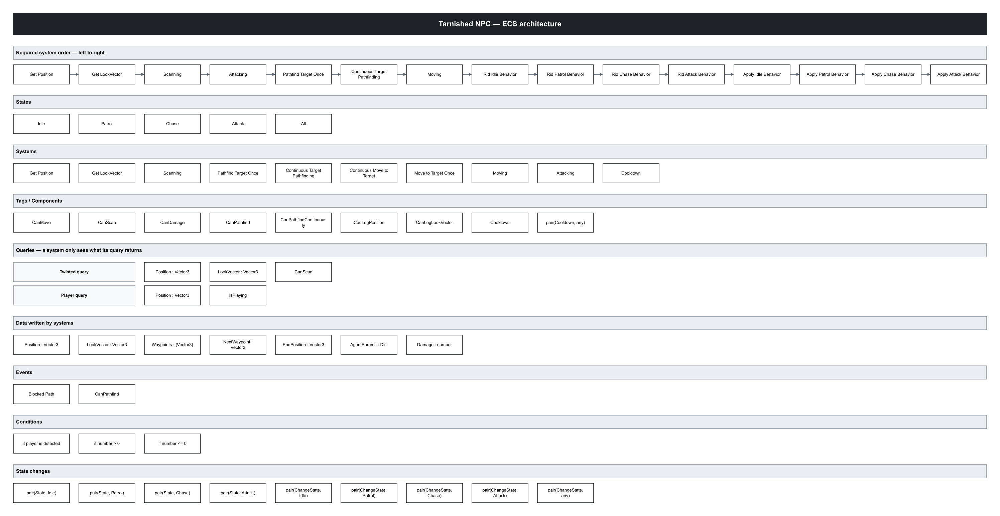
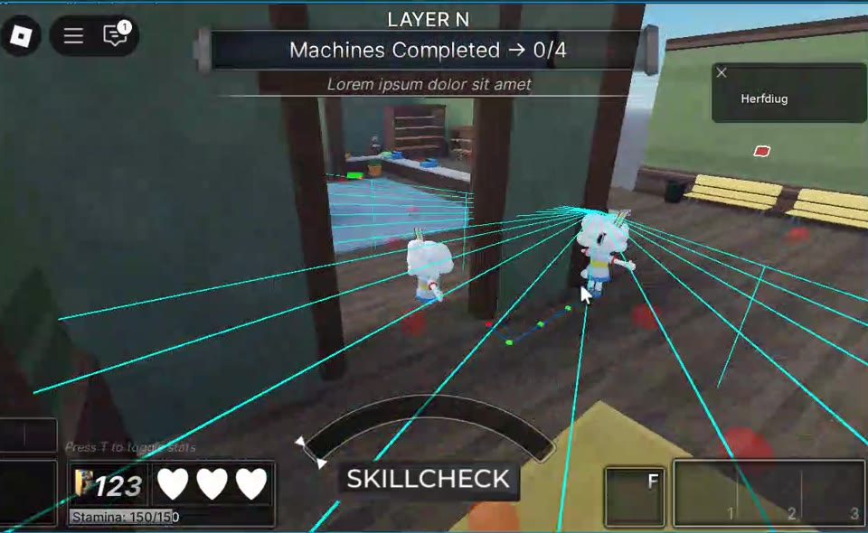

# TTA — an ECS-driven NPC, Dandy's World style

The design on one diagram: an NPC that idles, patrols, notices a player inside its vision cone, chases, and — on the diagram — attacks. It fixes what its states are, which systems run, what data each system is allowed to read, and the order they must run in.

**Why this exists:** a behaviour tree gets rewritten every time a new behaviour appears. With ECS, a behaviour is a set of components plus a system that reads them — so adding "patrol" means adding a system and a tag, not editing an `if` chain. The diagram is the contract that makes that true.

Files: `TTA_ECS.png` (what you're looking at), `TTA_ECS.svg` (same thing, sharp at any zoom), `TTA_ECS.drawio` (the editable source — open it in [diagrams.net](https://app.diagrams.net) or the VS Code Draw.io extension), and `src/` (the systems folder from the test place, described under [Source](#source)).

Read it at full size: bands stack top to bottom, boxes read left to right.

## Layers in the diagram

| Band | What it holds |
|---|---|
| **Required system order** | The order that must hold, left to right: `Get Position`, `Get LookVector`, `Scanning`, `Attacking`, `Pathfind Target Once`, `Continuous Target Pathfinding`, `Moving`, then `Rid ×4` and `Apply ×4` behaviour boxes. Wrong order reads last frame's data. |
| **States** | `Idle`, `Patrol`, `Chase`, `Attack`, and `All` at the join. |
| **Systems** | `Get Position`, `Get LookVector`, `Scanning`, `Pathfind Target Once`, `Continuous Target Pathfinding`, `Continuous Move to Target`, `Move to Target Once`, `Moving`, `Attacking`, `Cooldown`. |
| **Tags / Components** | `CanMove`, `CanScan`, `CanDamage`, `CanPathfind`, `CanPathfindContinuously`, `CanLogPosition`, `CanLogLookVector`, `Cooldown`, `pair(Cooldown, any)`. |
| **Queries** | `Twisted query` (`Position`, `LookVector`, `CanScan`) and `Player query` (`Position`, `IsPlaying`). A system only sees what its query returns. |
| **Data written by systems** | `Position : Vector3`, `LookVector : Vector3`, `Waypoints : {Vector3}`, `NextWaypoint : Vector3`, `EndPosition : Vector3`, `AgentParams : Dict`, `Damage : number`. |
| **Events** | `Blocked Path`, `CanPathfind` — what a system emits instead of calling another system directly. |
| **Conditions** | `if player is detected`, `if number > 0`, `if number <= 0` — the guards that sit between a query and an action. |
| **State changes** | `pair(State, Idle / Patrol / Chase / Attack)` written by a query, and `pair(ChangeState, Idle / Patrol / Chase / Attack / any)` applied in one place. |

`AgentParams` is the dictionary you hand to `PathfindingService:CreatePath` — `AgentRadius`, `AgentHeight`, `AgentCanJump`, `WaypointSpacing`. The first version of the diagram called it `AgentRadius`, which was wrong: that's one key inside it, not the whole thing.

## The three decisions worth reading

1. **Cooldowns are data, not a system.** `pair(Cooldown, any)` is charged on the entity, and the `Cooldown` system only decrements. That keeps "can I attack" out of the attack branch.
2. **State transitions are events, not mutations.** Systems emit `pair(ChangeState, …)`; one system applies it. Nothing writes `State` from three places.
3. **Behaviour is attached and removed, not branched.** `Apply X Behavior` / `Rid X Behavior` are explicit enters and exits, so a state change cannot leave a stale behaviour running.

## Status

Prototype, not a finished game. Three artefacts, and they are not the same thing:

- **The diagram** — the whole design: states, systems, queries, events, and the order they run in.
- **The code in `src/`** — the systems half, as it runs in the test place: player entity, scan, pathfind, move.
- **The clip** — the behaviour before the ECS rewrite, filmed in the same test place.

Still design only: `Attack`, the cooldown pair, the events band, and the state layer (`Idle`, `Patrol`, `Chase`) as drawn.

### Source

The systems folder out of the test place, published as it runs there. The paths are the place's paths:

| Path | What it is |
|---|---|
| `src/Modules/World.luau` | the Jecs world, plus the shared types (`Character`, `Heart`, `VisionInfo`) |
| `src/Modules/EntityService.luau` | get-or-add for entities, tags and components, by name |
| `src/Modules/LuauFuturesExtension.luau` | a thin shim over LuauFutures: collect the deferred futures, then poll or await them together |
| `src/Modules/NodeService.luau` | the waypoint graph `PathfindSystem` builds patrol paths from |
| `src/Modules/SystemModules/PlayerSystem.luau` | a joining player becomes an entity with `Character` and `Heart` |
| `src/Modules/SystemModules/ScanSystem.luau` | the `Scanning` band: caches player positions, writes `CharacterDistances`, sets `Prey` inside the instant-chase radius |
| `src/Modules/SystemModules/PathfindSystem.luau` | node path when it has a node chain, `PathfindingService` path when it has prey |
| `src/Modules/SystemModules/MoveSystem.luau` | the `Moving` band: `Humanoid:MoveTo` one waypoint at a time, index advances on arrival |
| `src/Scripts/Scheduler.server.luau` | the order — `ScanSystem` → `PathfindSystem` → `MoveSystem`, every Heartbeat |

Two modules are deliberately not here, because they are not mine: **Jecs** (the entity/component store, MIT, by [Ukendio](https://github.com/Ukendio/jecs)) and **LuauFutures** (the polling future that keeps `ComputeAsync` off the frame). The requires point at `ServerScriptService.Modules.<Name>`; drop both in there and the folder runs.

The diagram's names are the later ones: `ScanSystem` is the `Scanning` band, `PathfindSystem` covers the two pathfinding systems, `MoveSystem` is `Moving`. `PlayerSystem` is a stub — it clones `workspace.Camera.ToonGurt` and assigns that as the player's character.

### Running slice

**[Watch the clip — 10 s, no audio, cut from a longer recording](media/tta-prototype.mp4)**

Filmed before the rewrite, in the same test place: the NPC moving with its detection area drawn. The cyan wireframe is the volume it tests players against, generated by its own debug code and left switched on so the decision is visible instead of assumed. The `Idle` / `Patrol` / `Chase` in that clip is the earlier procedural version; the ECS version in `src/` is the systems half, without the state layer yet.

What is not there yet is also the honest part: the place around it is half-built (the objective banner is still placeholder text, and `Attack` does not exist), and the debug output prints once per frame instead of on a timer.

The value of the diagram is the ordering and the query boundaries — the parts that are expensive to change later.

The first version stacked three copies of the same table — present, added/changed, removed — which made the same label appear three times and left section headers sitting inside each other's rows. This version keeps one copy of each concept, puts the bands in reading order, and folds the per-state deltas into the tags and state-change bands. The per-state "what gets added, what gets removed" detail is not shown here; that is the next diagram.

## Next

- One system per column, with the query as its signature.
- A test place with two agents sharing the same systems and different component sets, to prove behaviour is data.